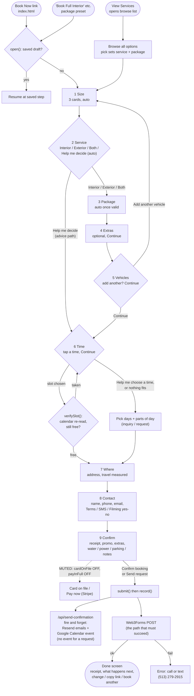

# Booking pipeline: how it works, what it asks, and how to make it shorter

Internal working document, written 2026-11-09 against branch `eNov6`. Every count below was taken from the code, not from clicking through the site. Line numbers are from that read; `js/funnel.js` was being edited at the same time, so they may have shifted a little.

Contents:

1. Flow diagram
2. Counts: screens, taps, fields
3. Everything we ask vs the minimum needed to book
4. Recommended improvements, ranked by impact and effort
5. Main recommendation: a weekly calendar time picker
6. Questions for the owner

---

## 1. Flow diagram

The funnel is a modal opened from any "Book Now" link (`js/funnel.js:5139`). There are nine steps in `STEPS` (`js/funnel.js:131-143`). Steps marked `auto` move on as soon as one card is tapped. The rest need Continue. `advance()` also skips any `auto` step that is already answered (`js/funnel.js:982`), which is why a package card on the home page goes straight from Size to Extras.

Notes on the diagram:

- **Payment is muted.** `cardOnFile` and `payInFull` are both `live: false` (`web/lib/site/capabilities.ts:30`, `:73`), so `rPay()` shows "Nothing to pay today" and `vPay()` returns no error (`js/funnel.js:3360`, `:3467`). No card field, no authorization checkbox, no pay-now option.
- **Availability** comes from Google Calendar: events titled `OPEN` are bookable hours and anything else is busy (`web/lib/google/publicCalendar.ts:10-20`, `js/config.template.js:20-29`). Elijah's personal calendar is added as extra busy time through `/api/personal-busy` (`js/funnel.js` `loadSlots()`).
- **Before leaving the Time step**, `verifySlot()` reads the calendar again for that day and sends the customer back if the time has gone (`js/funnel.js:893-960`).
- **Submission** (`record()`, `js/funnel.js:4481`) sends `/api/send-confirmation` first without waiting for it. That function emails through Resend and writes the calendar event, except for a request (`netlify/functions/send-confirmation.mjs:403-411`). The Web3Forms post is the one that decides whether the customer sees the Done screen. A retry after a Web3Forms failure reuses an idempotency key, so the calendar still gets only one event.
- **Help me decide** skips Package, Extras and Vehicles (`skip: advising`). It still books a real time, holding 4 hours (`ADVICE_HOLD_MIN = 240`, `web/lib/pricing/wire.ts:179`).

---

## 2. Counts

### How I counted

- **Screen**: one funnel step the customer actually sees. The Done screen is counted separately.
- **Tap**: one click or tap on a control (a card, button, yes/no, suggestion, Continue). Tapping into a text field to type is **not** counted here. Typed fields are counted in their own column. Add about one tap per typed field if you want a raw tap count, or none when browser autofill fills them.
- **Shortest typical path**: one vehicle, Interior or Exterior (not Both), a package that needs no correction tier, no add-ons, the suggested time inside a band, Places address suggestion used, no promo code, all optional questions skipped.
- **Required**: the validator blocks Continue without it (`vSize`, `vIntent`, `vPackage`, `vTime`, `vLoc`, `vContact`, `vPay`).

### Per step, shortest typical path

| # | Step (tab) | Min taps | Typed: req / opt | Choices: req / opt | Yes/no and checkboxes: req / opt | Notes |
|---|---|---|---|---|---|---|
| 0 | "Book Now" on the page | 1 | | | | Opens the modal (`js/funnel.js:5139`) |
| 1 | Size (Vehicle) | 1 | 0 / 0 | 1 / 0 | 0 / 0 | 3 cards, auto (`rSize` :998) |
| 2 | Service | 1 | 0 / 0 | 1 / 1 | 0 / 0 | 4 cards incl. Help me decide, auto. Optional: "Browse through all options" (`rIntent` :1014) |
| 3 | Package | 1 | 0 / 1 | 1 / 0 | 0 / 0 | Auto once valid (`:4001-4011`). Promo box appears once there is a price. "Both" needs 2 taps |
| 4 | Extras | 1 | 0 / 0 | 0 / 1 group | 0 / 0 | Continue only. Every add-on and tier is listed (`rAddons` :1370) |
| 5 | Vehicles | 1 | 0 / 1 | 0 / 1 | 0 / 0 | Continue only. Optional "What are we detailing?" and "Add another vehicle" (`rMore` :1685) |
| 6 | Time | 2 | 0 / 0 | 1 / 5 | 0 / 1 | Tap a band (books its suggested start) + Continue. Optional: Help me choose a time, Jump to a date, Got a time in mind, Expand other times, Show more days. Checkbox: "I need it within 3 days" (`rTime` :1726) |
| 7 | Where | 2 | 3 / 0 | 1 (defaulted) / 0 | 0 / 1 | Street, City, ZIP typed. State defaults to OH. Suggestion pick + Continue. Optional "no good location" + note (`rLoc` :1449) |
| 8 | Contact (Accept) | 4 | 2 / 1 | 0 / 0 | 3 / 0 | Name, phone; email optional. Terms (must be Yes), SMS, Filming each need Yes or No (`vContact` :2875) |
| 9 | Confirm | 1 | 0 / 3 | 0 / 3 | 0 / 0 | "Confirm booking". Optional: promo, extras dropdown, water, power (Yes / No / Not sure), parking, notes (`rPay` :3241) |
| | Done | 0 | | | | Receipt, What happens next, Close |

### Totals, shortest typical path

| Measure | Count |
|---|---|
| Screens to book | **9** steps, then the Done screen |
| Minimum taps, "Book Now" to booked | **15** (14 if the address is typed in full without picking the suggestion) |
| Required typed fields | **5** (street, city, ZIP, name, phone) |
| Required choices | **4** answered (size, service, package, time) + 1 defaulted (state) |
| Required yes/no answers | **3** (terms, SMS, filming) |
| **Required inputs in all** | **12 answered + 1 defaulted = 13** |
| Optional inputs shown on the way | **15** distinct (promo, add-ons, vehicle name, add vehicle, help me choose a time, rush checkbox, jump date, jump time, no-location checkbox, email, extras dropdown, water, power, parking, notes), plus the location note when it opens. The promo box appears on two screens |

One tidy-up issue: the Places suggestion writes the **whole formatted address** into Street and then moves focus to City (`js/funnel.js:5044-5052`), so the customer still types the city and ZIP that the suggestion already contained. `addressLine()` then sends city, state and ZIP twice to `/api/travel`. It works, but it costs two typed fields.

### Other paths, briefly

| Path | Screens | Min taps | Difference |
|---|---|---|---|
| Package card on the home page ("Book Full Interior", `index.html:816-922`) | 7 | 13 | Service and Package are already answered and skipped |
| Help me decide | 6 | 12 | No Package, Extras or Vehicles. Confirm screen asks "What condition is it in" (optional, not validated). 4 hours held on the calendar |
| Request instead of a time (Help me choose a time, or no slot fits) | 9 | 16 | Time step becomes switch + at least one day or part of day + Continue. No calendar event is written. Button reads "Send request" |
| Each extra vehicle | +4 new screens (and Vehicles again) | +5 | Add another vehicle, Size, Service, Package, Extras Continue. Optional "My vehicles need separate times" checkbox on Time |
| Both (interior + exterior) | 9 | 16 | One package from each list |

---

## 3. Everything we ask vs the minimum needed to book

Key: **Keep** = needed to book. **Infer** = we can work it out from another answer. **Defer** = ask after the booking is sent (confirmation email reply, day-before text, or Done screen). **Optional** = keep, never required. **Not asked** = switched off today.

| Currently asked (from the code) | Minimum version |
|---|---|
| Vehicle size: Small / Medium / Large | **Keep.** Changes price (+$0 / +$10 / +$25, `web/lib/catalog/seed.ts:27-29`) and job length |
| Service: Interior / Exterior / Both / Help me decide | **Infer** from the package. It only filters the package list. Show both lists on one screen and keep Help me decide as an option there |
| Package (one per category) | **Keep**, or Help me decide. Sets price, duration and which times fit |
| Correction level (Showroom Ready Exterior only, currently coming soon) | **Keep** when that package is bookable |
| "Tell me when" interest toggles | **Optional** |
| Add-ons (Extras step) | **Optional.** Already offered again on the Confirm screen (`extrasBlock()`), so one of the two could go |
| Promo code (Package screen and Confirm screen) | **Optional.** One location is enough |
| Add another vehicle | **Optional.** Could be a link, not a whole screen |
| "What are we detailing?" (vehicle name) | **Defer**, or make it optional on Confirm |
| Start time | **Keep**, or a request for days and parts of the day |
| "I need it within 3 days" checkbox | **Infer.** The surcharge is already worked out from the slot, not from the checkbox (`surchargeCtx()`), and picking a rush day ticks it automatically (`js/funnel.js:4053-4062`) |
| Jump to a date / Got a time in mind | **Optional** navigation. Replaced by week chevrons in section 5 |
| Help me choose a time (days + parts of day) | **Optional** alternative path. Keep |
| My vehicles need separate times (2+ vehicles) | **Optional.** Keep |
| Street address | **Keep.** Where to go, and the measured drive that sets the travel fee (`measuredTravel` is live) |
| City | **Infer** from the Places pick or from the ZIP |
| State (defaults OH) | **Infer** from the Places pick |
| ZIP | **Keep**, but fill it from the Places pick. Sets tax and the fallback travel band (`vLoc`, "so we can work out tax and travel") |
| "I do not have a good location" + note | **Optional.** Keep |
| Name | **Keep** |
| Phone | **Keep.** Confirmation, and Elijah texts the ETA by hand |
| Email | **Optional** (it already is). Needed only for the emailed confirmation |
| Terms and privacy: Yes / No | **Keep**, as one required checkbox. It is what makes the cancellation fee enforceable |
| Texts about this booking: Yes / No | **Optional**, as an unticked checkbox. Automated texts are off (`automatedTexts`, `capabilities.ts:124`). When they go on, carrier (A2P 10DLC) rules expect a clear opt-in that is not a condition of booking. Manual texts about a booking the customer asked for are generally treated differently, but confirm with whoever advises on the legal pages |
| Filming and photos: Yes / No | **Defer** or **Optional.** Nothing about the booking depends on it |
| Card on file + authorization | **Not asked** (`cardOnFile` off) |
| Pay now for 5% off | **Not asked** (`payInFull` off) |
| Extras dropdown on Confirm | **Optional** |
| Outdoor tap: Yes / No / Not sure | **Defer.** The copy itself says no answer changes the price |
| Outdoor outlet: Yes / No / Not sure | **Defer** |
| Parking and access note | **Defer**, or optional |
| Anything else we should know | **Optional.** Keep the one box |
| (Help me decide) What condition is it in | **Optional**, but keep: it is what the recommendation is based on |

**Bare minimum to book a mobile detail: 8 inputs.** Vehicle size, package (or Help me decide), start time, street address, ZIP (filled in by the address pick), name, phone, and accepting the terms. Today we require 13.

---

## 4. Recommended improvements

Design rule for all of these: the current look stays. Same cards, colors, type, buttons and modal. These are removals, merges and reorderings.

| # | Change | Principle | Impact | Effort | Saves |
|---|---|---|---|---|---|
| 1 | **Fill City, State and ZIP from the Places pick** (Place Details `addressComponents`; the session token `acToken` already exists, `js/funnel.js:4343`), and stop writing the full formatted line into Street. If Places is unavailable, fill City from the ZIP using the local ZIP tables in `web/lib/travel/` | Autofill, "don't ask for what you know" (Baymard: address autocomplete and ZIP-based city lookup) | High | Low | 2 typed fields |
| 2 | **Terms as one required checkbox; SMS as an optional unticked checkbox; filming moved to the Done screen or the confirmation email** | Hick's law (fewer decisions), progressive disclosure, no forced choices for optional consent | High | Low | 2 to 3 taps, 2 required answers |
| 3 | **Fold "Add another vehicle" into the Extras screen** as a line with the 10% saving, and drop the Vehicles screen | Fewer steps (Baymard: every extra checkout step costs completions) | Medium | Low | 1 screen, 1 tap |
| 4 | **Remove the "I need it within 3 days" checkbox.** Rush days are already labeled "Rush, +20%" on the day and the checkbox ticks itself | Don't ask what you can infer, signal to noise | Medium | Low | 1 control, a paragraph of copy |
| 5 | **Inline validation on blur** for phone and ZIP, using the same rules `vContact`/`vLoc` apply on Continue | Inline validation (Wroblewski's study: fewer errors, faster completion) | Medium | Low | Error round trips |
| 6 | **Merge Service into Package**: Interior and Exterior headings on one screen (the "Both" layout already does this), Help me decide as a card at the top | Hick's law vs a filter step that adds no information | High | Medium | 1 screen, 1 tap |
| 7 | **Move water, power and parking off the Confirm screen** to the Done screen ("Help us prepare, optional") or the confirmation email | Progressive disclosure: keep the last screen about confirming (Baymard: keep the review step short) | Medium | Medium (needs a second send) | 4 optional fields off the critical screen |
| 8 | **One home for add-ons and promo.** Either the Extras step or the Confirm dropdown, not both; promo on Confirm only | Consistency, less repetition | Low to medium | Low | Repeated content |
| 9 | **Single column on phones** for Name / Phone and City / State / ZIP if they do not already stack | Single-column forms (CXL and Baymard: faster, fewer missed fields) | Low | Low | |
| 10 | **Progress bar**: base it on the steps on the customer's path, not all 9 (`render()` divides by `STEPS.length`, so Help me decide jumps from 22% to 67%) | Accurate progress indicators | Low | Low | |
| 11 | **Weekly calendar time picker** (section 5) | Recognition over recall, Fitts's law, scanability | High | Medium to high | See below |

If 1 to 4 and 6 ship, the shortest path goes from **9 screens, 15 taps, 5 typed, 13 required** to about **7 screens, 11 taps, 3 typed (street, name, phone), 8 answered by the customer**. That is a projection, not a measurement.

Not recommended: moving Where before Time. It looks more natural, but the travel fee is measured at the chosen time (traffic matters), which is why the order is Time then Where (`measureTravel()` keys on the slot).

---

## 5. Main recommendation: weekly calendar time picker

The owner's idea: a weekly grid that opens on the current week, with chevrons to change weeks, colored by whether each hour is free at the normal price, free with a fee, or not available. Same backend: Google Calendar OPEN blocks, `computeSlots()`, the surcharge rules.

### 5.1 Do early and late fees exist? Yes, plus a separate rush fee

From `web/lib/pricing/rules.ts:155-164` and `web/lib/pricing/surcharge.ts:39-53`:

| Fee | Name in code | When | Amount |
|---|---|---|---|
| Early or late start | time-of-day surcharge (`timeOfDayBp`) | Start **before 10:00am** or **at or after 6:00pm**. Judged on the start time only | +20% |
| Rush | Priority Booking (`priorityBp`), shown to customers as "Rush" | Any start on a day inside the **3 calendar day** lead window (on Monday, Monday to Wednesday) | +20% |
| Both | capped (`maxTotalBp: 3000`) | Early or late **and** rush | +30% total |

Both apply to service and add-ons only, never to travel. They are worked out from the slot on the server too (`slotNeedsPriority`), so the grid only has to display them.

The funnel already uses the same edges for its four bands (`TIME_BANDS`, `web/lib/availability/slots.ts:324`): Early Morning 6 to 10am (fee), Midday 10am to 2pm, Afternoon 2 to 6pm, Late Evening 6 to 10pm (fee). A test keeps the band edges and the fee edges equal.

Small fix to note: the comment in `surcharge.ts:29-31` says the cap stops the two fees stacking ("one flat 20%"), but `maxTotalBp` is 3000, so they do stack to 30%. The funnel copy uses 30%, which matches the rule. Only the comment is wrong.

### 5.2 Which days: Monday to Friday, or every day?

**This conflicts with the business plan, so it is a question for the owner, not a decision.**

- The owner asked for a Monday to Friday week.
- Planned capacity is 3 jobs Sunday, 3 Monday, then 1 a day Tuesday to Saturday (`docs/DELIVERABLES-2026-11-13.md:81`). Sunday and Saturday are working days and hold 4 of about 11 weekly jobs.
- The code treats all seven days as bookable: `DEFAULT_HOURS.days = [0..6]` (`publicCalendar.ts:173`), weekends get three anchor starts instead of two "because those are the days worth filling hardest" (`slots.ts:483-490`), and correction work is weekend-only (`allowedWeekdays: [0, 6]`). A Monday to Friday grid would hide about a third of capacity and leave correction work with no times at all.
- The 3 / 3 / 1 pattern is **not enforced anywhere in code**. It only exists if the OPEN blocks on the calendar are set up that way.

**Recommendation:** show **Sunday to Saturday** (US week, and Sunday is a busy day). Days with no OPEN hours show as unavailable, so a closed day still reads clearly.

### 5.3 Colors and legend

| State | Fill | Signal besides color | Meaning |
|---|---|---|---|
| Available | Green tint, `#1a8a3f` border (the existing "Standard price" green, `book.css:294`) | Check icon; "Standard price" in the label | You can start this hour at the normal price |
| Available with a fee | **Amber** tint `rgba(240,169,63,.16)` (the existing Rush tag, `book.css:1040-1046`) | "+$36" (or "+20%") in dark amber `#7a5209` | You can start this hour; an early, late or rush fee applies |
| Unavailable | Light grey with diagonal hatching | No icon, no text; "Unavailable" for screen readers | Booked, outside open hours, or too short for this job |
| Selected | Existing selected style: `--red` border (`.bk-band.on`, `book.css:281`) | Filled check, end time shown underneath | Your pick |

**Amber/orange, not yellow.** Yellow on white fails the 3:1 contrast WCAG asks of non-text elements and is hard to read as text. Amber still reads as "between green and red", and the funnel already uses this exact amber and brown for Rush and premium bands, so nothing new is added to the palette.

**Red for "booked" clashes with the brand.** The brand red `#c41414` is the funnel's selected-state and main-button color. Red cells for "booked" next to a red outline for "selected" would make the two hard to tell apart, and red reads as an error. Recommendation: grey hatching for unavailable, red stays "your choice". If the owner wants red for booked, the selected style has to change, which goes against the no-redesign rule. That is an owner question.

**Color-blind safety.** The three states differ in brightness (dark green border, light amber fill, pale grey hatch) and each has its own icon or pattern, so they do not rely on red versus green. The amber cell's fee text in `#7a5209` is about 6:1 on its fill.

**Legend**, always visible above the grid in one row (wraps on phones). No em dashes, plain words:

> ✓ Standard price  ·  +$ Early, late or rush fee  ·  ▨ Unavailable
> Early is before 10am, late is 6pm or later, rush is within 3 days. Early or late plus rush is 30% in total. Times are Cincinnati time.

(The ✓ and ▨ stand for the inline SVG icon and hatch swatch, not emoji.)

### 5.4 Desktop and tablet layout (modal wider than 560px)

The modal is up to 680px wide (`book.css:41`).

- **Header row:** "Nov 9 to 15" on the left. In the top right, `‹` and `›` chevron buttons, at least 44×44px, plus a small "Today" button once the customer has moved away from the current week. Below the chevrons, keep the existing "Jump to a date" (`jumpBox()`) as a small link for long jumps; it moves the grid to the week holding that date.
- **Columns:** 7 days, Sunday to Saturday, about 80px each, plus a 56px time column. Each day header shows "Tue 11" and, for days inside the lead window, the existing "Rush +20%" tag.
- **Rows:** one per start hour. Bookable starts run 6am to 10pm (`DEFAULT_BOOKING_WINDOW`, `slots.ts:114-123`; exterior work must start by 8pm). Show only the hours from the earliest to the latest open start in the visible week, but always at least 10am to 6pm so the standard-price block stays put when the week changes. At most 17 rows.
- **Band dividers:** thin labeled rules at 10am, 2pm and 6pm using the existing band names (Early Morning, Midday, Afternoon, Late Evening). The fee edges then line up with something the customer has already seen.
- **Today:** past hours show as unavailable. Days before today in the current week are dimmed.

### 5.5 Selecting a time

- A cell is a **start hour**, not the whole appointment. The cell is available if `computeSlots()` returns any start in `[hour, hour + 60)` for this job's length. Its color is the best price among those starts.
- **One tap selects** the suggested start in that hour: the `:00` start if there is one, otherwise `:30`. Use `recommendStarts()` within the hour so a start right after an existing job wins, as the bands do now.
- If both `:00` and `:30` exist, show two small chips under the grid ("10:00am" / "10:30am") with the suggested one selected. No extra tap needed.
- Under the grid, one summary line: "Tuesday Nov 11, 10am. We arrive between 10 and 11, and a 4 hour detail runs to about 2pm. Standard price." For a fee: "+$36 early start fee." Then Continue, which still runs `verifySlot()`.
- **Day-packing:** the band picker hides all but the suggested start in each band on purpose, so that one 1pm booking does not ruin a day that could take 10am and 4pm (`js/funnel.js:2451-2477`). A full grid shows every hour. Options: (a) show every valid hour and mark suggested ones with a small dot, or (b) color only the suggested starts and put the rest behind "Show all times". **Owner question.** (a) is simpler for customers; (b) protects the schedule.

### 5.6 Phones (560px and narrower)

Seven columns at 375px gives about 40px per cell with a time column. That is under the 44px touch target in Apple's guidelines, and two-way scrolling inside a scrolling modal is easy to get lost in. Horizontal scrolling hides days off screen. So on phones, use **a day strip plus an hour list**:

- **Header:** "Nov 9 to 15" with `‹ ›` on the right, same as desktop.
- **Day strip:** 7 equal chips (about 46px wide each), showing "Sun" and "9". Under each, a 4px status bar: green if the day has any standard-price start, amber if it only has fee starts, grey hatch if none. Rush days carry a tiny "Rush" label. The selected day uses the existing selected style.
- **Default day:** the first day this week with any availability.
- **Hour list** for the chosen day, grouped under the four band headings, one 48px row per available start hour: "10am · Standard price ✓" or "8am · +$36 early start". Unavailable hours are left out, with one line under each band such as "Afternoon: nothing open". This is the familiar Calendly/OpenTable layout and reuses the existing band names and row styles.
- Swiping the strip sideways can also change week, but the chevrons are the main control.

### 5.7 Accessibility

- **Desktop grid:** `role="grid"` labeled by the week heading. One cell in the tab order at a time (roving `tabindex`). Arrow keys move by hour and day, Home/End go to the first and last hour, Page Up/Page Down change week, Enter or Space selects.
- **Cell names:** every cell has a full label, for example "Tuesday November 11, 10 AM start, standard price" / "Saturday November 15, 8 AM start, plus $36 early start fee" / "Wednesday November 12, 2 PM, unavailable". Unavailable cells get `aria-disabled="true"` but stay reachable so the grid can be explored.
- **Selected cell:** `aria-selected="true"`.
- **Chevrons:** real buttons named "Previous week" and "Next week". "Previous" is disabled on the current week.
- **Announcements:** a polite live region reads out week changes ("Week of November 16. 9 open start times.") and the chosen time.
- **Phones:** the day strip is a `tablist` and the hour list is ordinary buttons.
- **Other:** visible focus ring (the existing one). No information carried by color alone (5.3). Respect `prefers-reduced-motion` for the loading shimmer. Targets at least 44px on touch.
- **Time zone:** compute days and hours in America/New_York (`P.localMinutesOfDay`, `web/lib/time/zone.ts`), not the visitor's zone, and say "Cincinnati time" in the legend.

### 5.8 Empty weeks, look-ahead, loading

- **Empty week:** the grid stays, all hatched, with a message over it: "Nothing open this week for a 4 hour detail." Under it, a button "Next opening: Tuesday Nov 18" (search forward with the same `computeSlots()` call) and the existing "Help me choose a time" link. Never disable the forward chevron because of an empty week.
- **How far ahead:** the code allows 365 days (`MAX_BOOK_DAYS`, `js/funnel.js:2557`), and in practice the OPEN blocks decide. Stop the forward chevron at `MAX_BOOK_DAYS`. Whether to show a shorter horizon, such as 8 weeks, is an owner question.
- **Loading:** draw the headers straight away (the dates are known) with a shimmering empty grid at its final height, so nothing jumps. Keep the existing 8 second fallback to standard hours (`loadSlots()` `giveUp`). After a week is drawn, quietly fetch the next week. Store each week's result so going back is instant. Drop any reply that arrives for a week the customer has already left.

### 5.9 How it maps onto the existing code

Nothing on the server changes. In the browser it only replaces how `#bkSlots` is drawn.

| Piece | Today | Weekly grid |
|---|---|---|
| Window | `loadSlots()` reads from now to `daysShown + 14` days (at least 28), or 7 days from `jumpDate` | Same function, window = `[weekStart, weekStart + 7 days)` (fetch 14 to prefetch). New `state.weekStart`, replacing `daysShown` and `openBand` |
| Calendar data | `P.loadWindow(cfg, from, to)` + `/api/personal-busy` | Unchanged |
| Valid starts | `P.computeSlots(req)` in `paintSlotsInner()` with buffers, `hasExterior`, booking window | Unchanged. Same `req`, same 30-minute grid |
| Grouping | `P.groupIntoBands()` per day, first 3 days | Group by day, then hour, in Cincinnati time. Band edges become row dividers |
| Suggested start | `P.recommendStarts()` per band | Same, per hour cell |
| Fee shown | `deltaFor(ms)` → `P.computeSurcharge()` with `needsPriority(ms)` | Unchanged; decides green vs amber and the "+$" label |
| Selecting | `[data-slot]` click handler sets `state.slot` in place (`js/funnel.js:4064`) and ticks rush if needed (`:4053`) | Cells carry `data-slot`, so the same handler works |
| Checking | `checkThenAdvance()` / `verifySlot()` | Unchanged |
| Multi-day and correction jobs | `paintMultiDay()` list | Keep the list. A job spread over several days does not fit an hour grid |
| Help me choose a time / request | `timeSwitch()`, `preferPicker()`, `inquiryPanel()` | Unchanged, still at the top of the step |
| Help me decide | `holdMinutes()` = 240 min | Unchanged; the grid uses the 4 hour hold |
| Tests | `web/lib/funnel.smoke.test.mjs` | Update for the new markup. Add a test that a cell's color agrees with `computeSurcharge()` for that start |

---

## 6. Questions for the owner

1. **Week shape.** Monday to Friday was requested, but planned capacity includes 3 jobs on Sunday and 1 on Saturday, and correction work is weekend-only. Show Sunday to Saturday?
2. **Red for booked.** Red is the brand's "selected" and button color. OK to show unavailable hours as grey hatching and keep red for "your choice"?
3. **Booked vs closed.** Show booked hours differently from hours that were never open, or one "Unavailable" state? (One state is simpler and does not show how full the calendar is.)
4. **Every hour, or only suggested starts?** The current picker steers people to 10am and 4pm (10am, 1pm and 4pm at weekends) to keep days packable. A full grid shows every free hour.
5. **How far ahead?** Code allows a year. Cap it, for example at 8 weeks?
6. **Consent questions.** OK to turn SMS into an optional unticked checkbox and move filming consent after booking? Forcing a Yes or No probably gets more yeses for filming, so this trades opt-in rate for a shorter form.
7. **Add-ons step.** Keep it as its own screen for the upsell, or rely on the Confirm screen's "Want to add anything?" panel?
8. **Capacity.** Is the 3 / 3 / 1 / 1 / 1 / 1 / 1 pattern set up in the OPEN blocks? Nothing in code caps jobs per day. With Chris joining, the scheduler still assumes one person (`docs/DELIVERABLES-2026-11-13.md:84`).
