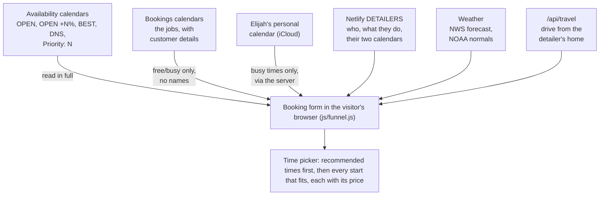
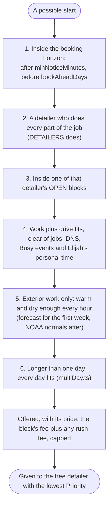
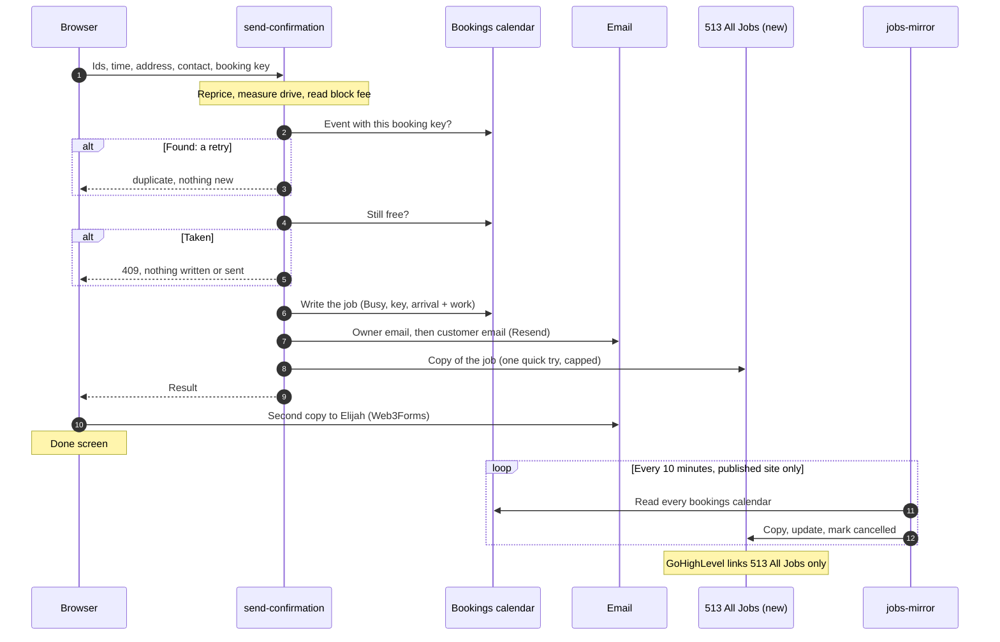
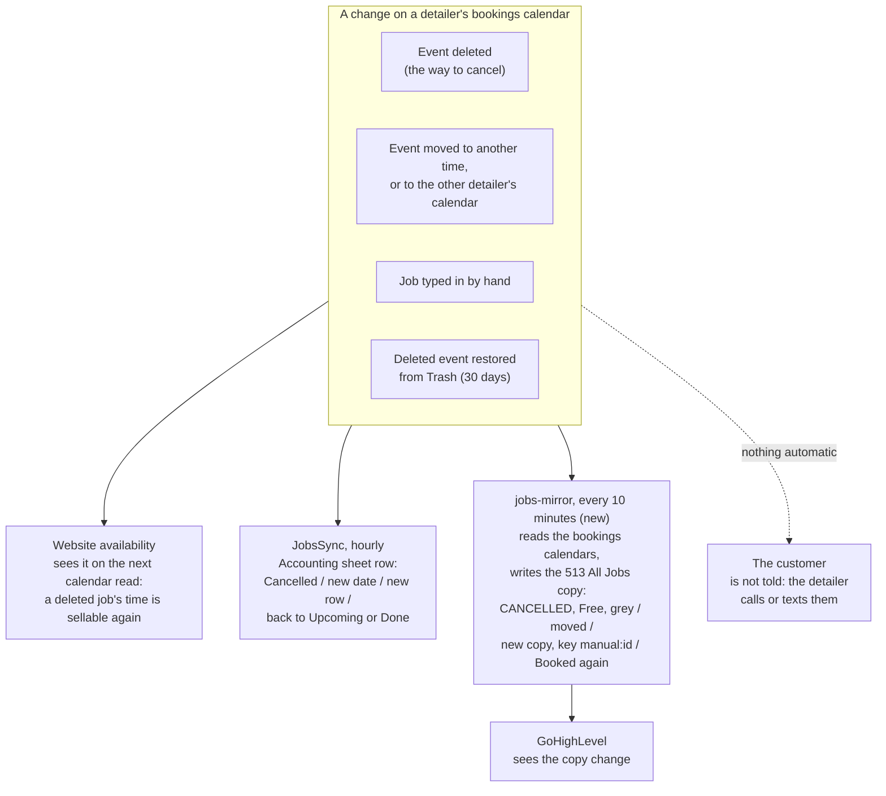
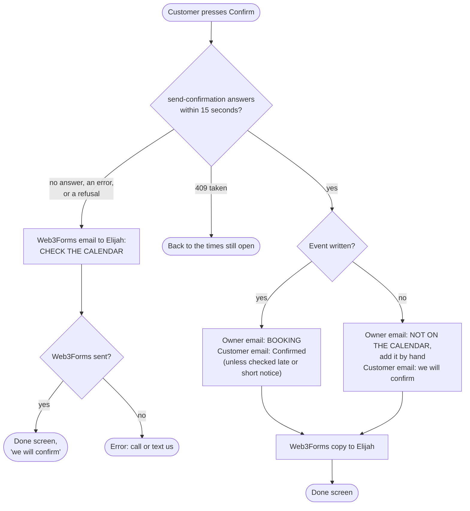

# Booking process flow: from a detailer's calendar to GoHighLevel

For Imperion, who are connecting GoHighLevel (GHL). Written November 26, 2026, against branch `eNov14` (commit `a2a5869`), and brought up to date the same day for branch `master-calendar` (the master calendar, 513 All Jobs, as built), in plain language for someone who doesn't read code. File names are given so a developer can check each step. Its companion, `docs/BACKEND-LOGGING-STANDARD.md`, says what each step records. `docs/BOOKING-PIPELINE.md` (November 9) covers the booking form's screens and taps; this document starts where the customer has picked a time.

Contents:

1. Words used here
2. (a) How availability is tracked and shown to customers
3. (b) How a booking moves through the backend
4. (c) Cancellations, moves and hand-typed jobs
5. (d) What happens when a step fails
6. Open questions for Imperion

**Numbers.** Fees, notice periods and day counts are settings, so this document names the setting rather than typing its value (the value can change without this page knowing). The settings are in `config/scheduling.json`, `config/rush-fee.json`, `web/lib/pricing/rules.ts` (`DEFAULT_RULES`), `web/lib/availability/weather.ts` (`WEATHER_RULES`) and Netlify's `DETAILERS`.

---

## 1. Words used here

| Word | Meaning |
|---|---|
| **Availability calendar** | A detailer's Google calendar of working hours (513 Availability for Elijah, 513 Kris Availability for Kris). Public, holds nothing private |
| **Bookings calendar** | A detailer's Google calendar of jobs (513 Auto Clean for Elijah, 513 Kris Bookings for Kris). Holds customer details, so the public sees only "busy" |
| **OPEN block** | An event titled `OPEN` on an availability calendar: a stretch the detailer can work. `OPEN +N%` (for example `OPEN +20%`) is the same, with an early or late fee for starts inside it |
| **BEST** | An event titled `BEST`: a recommended start time. Only its start matters; it never blocks time |
| **DNS** | "Do not schedule": an event that blocks time, even when Google has it as Free |
| **Busy / Free** | Google Calendar's "Show as" setting. Busy events block time; Free ones don't (except DNS) |
| **Free/busy read** | Reading a calendar through Google's free/busy service: only start and end times come back, never a title, name or address |
| **Priority** | The line `Priority: N` in an availability calendar's description: who is offered a time first (lowest number first) |
| **Booking key** | A random id the booking form gives each booking (`bk_…`), stored hidden on the calendar event, so a retry is recognised as the same booking |
| **Idempotent** | Doing it twice has the same effect as once: a repeated booking makes no second event or email |
| **Arrival window** | "We arrive between 6 and 7pm": the start time plus `arrivalWindowMinutes` (`config/scheduling.json`, or a detailer's own `arrivalWindow`) |
| **Short notice** | A start inside `shortNoticeHours`: a request until a detailer accepts it |
| **Rush window** | The first few days from today, when the rush fee applies (`config/rush-fee.json`) |
| **Request** | A booking with no time chosen ("help me choose a time"). Nothing goes on the calendar |
| **Help me decide** | A booking with a time but no package. The calendar holds `ADVICE_HOLD_MIN` (`web/lib/pricing/wire.ts`) |
| **Netlify function** | A small program on the website's server (`netlify/functions/`). A **scheduled** function runs on a timer |
| **Resend** | The service that sends the site's own emails |
| **Web3Forms** | The service the browser uses to email Elijah a second copy of each booking, and the Contact form |
| **JobsSync** | Elijah's Apps Script that copies jobs from the bookings calendars into his Accounting sheet, hourly |
| **513 All Jobs** | The new private master calendar: one copy of every job, for GHL. Deploy Previews write to a separate **513 TEST All Jobs** |
| **Linked / conflict calendar** | GHL's terms: the linked calendar is where GHL's bookings sync; a conflict calendar only blocks GHL's times when its events are Busy |

---

## 2. (a) How availability is tracked and shown to customers

### Where availability comes from

Everything is set in Google Calendar by the detailers, so a change of hours, fees or best times needs no programmer and no redeploy (`docs/DETAILERS-GUIDE.md`, `docs/CALENDAR-SETUP.md`).

**What each kind of event does** (`resolveWindow()` in `web/lib/google/publicCalendar.ts`):

- **OPEN blocks** are the only bookable time. Busy or Free, they count. A start's early or late fee comes from the block it starts in: `OPEN` is the standard price, `OPEN +N%` adds N% (`openFeeBp()`). Where blocks overlap, the higher fee wins.
- **No OPEN block in the window means nothing is bookable** (mode `noOpen`). A day off is a deleted OPEN event.
- **BEST events** mark the recommended starts. They never block time.
- **DNS** blocks time, Busy or Free. **Any other Busy event** blocks time too (a dentist appointment). Free events other than OPEN and DNS are ignored.
- **Priority** comes from `Priority: N` in the calendar description; the lowest number found across a person's calendars wins. The order of `DETAILERS` breaks ties.

**Who can do the job** (`web/lib/availability/crew.ts`): each detailer's `does` in `DETAILERS` lists their work (`interior`, `exterior`, `correction`, `coating`, or `all`). A job goes only to someone who does every part of it; Kris does interior only, so a job with any exterior work is never offered on his calendar. On the server, `detailerFor()` in `netlify/functions/_detailers.mjs` refuses a detailer who can't do the job, even in a hand-edited request.

### What the browser reads, and why names never leave Google

`calendarCfgFor()` and `loadCrew()` in `js/funnel.js` decide what to read for each detailer:

- **Availability calendars:** read in full with the site's public calendar key. They hold only OPEN, BEST, DNS and personal blocks.
- **Bookings calendars:** read **only through Google's free/busy service** (`fetchBusyOnly()`): a list of busy start and end times. Kris's bookings calendar always; Elijah's 513 Auto Clean because it is listed in `GOOGLE_BUSY_ONLY_CALENDAR_IDS`. Both are public as "See only free/busy". So a customer's name, phone or address is never sent to a visitor's browser.
- **Elijah's personal calendar:** never sent to the browser. `/api/personal-busy` reads the feed on the server and returns busy times only, rounded outward to the half hour, on his times only.
- **The master calendar, 513 All Jobs, is never read** for availability.

If Elijah's calendars can't be read, the form shows standard hours, labelled as times still to confirm, and the server checks the time before writing it. If another detailer's can't be read, that detailer is left out.

### Whether a start is offered

A start is offered only when every check passes, in this order; the first one that fails removes it.

The rules behind each box:

- **Notice and horizon:** `minNoticeMinutes`, `bookAheadDays` and `acceptAheadDays` in `config/scheduling.json`.
- **The drive** (`travelBufferMin()` in `web/lib/availability/slots.ts`): measured by Google Routes from the detailer's home (`DETAILER_HOMES`, server only) or the shop (`SHOP_ORIGIN_ADDRESS`). A short drive is covered by an hour's buffer; a longer one sets the buffer itself. The drive may run into the arrival window. No drive home is counted after a late start, and no drive out before an early one (`IGNORE_RETURN_AFTER_MIN`, `IGNORE_OUTBOUND_BEFORE_MIN`). When the drive can't be measured, `driveFallbackMinutes` stands in. The travel fee is `DEFAULT_RULES.mileage`.
- **Weather** (`web/lib/availability/weather.ts`): limits per kind of work are `WEATHER_RULES` (coldest, rain, hot sun). Inside the National Weather Service forecast every hour of the job is checked. Past it, exterior work follows Cincinnati's typical temperature for each hour (NOAA 1991 to 2020 hourly normals, `normals-cvg.ts`). **Cold pause:** when no day in the next 14 (`horizonDays` in `js/funnel.js`) is warm enough for exterior work, the first step says so and names the likely day it comes back (`coldPause()`). It is judged on cold alone, never rain. A ceramic coating never blocks a booking; it moves to a warmer day.
- **Paint correction** has its own weekdays (`correctionWeekdays`) and start times (`CORRECTION_RULES`).
- **Multi-day jobs** (`web/lib/availability/multiDay.ts`): a job longer than one working day (`LONGEST_DAY`) is split across the fewest consecutive days, balanced, with a door-to-door limit (`MAX_DOOR_TO_DOOR_MIN`), starting at `LONG_JOB_STARTS`. Every day must fit.
- **Price** (`DEFAULT_RULES.surcharge`): the OPEN block's fee; if no block can be read, the clock rule (`earlyBeforeMinutes`, `lateFromMinutes`, `timeOfDayBp`). The rush fee (`priorityBp`) applies inside the rush window, which `rushWindow()` reads from `config/rush-fee.json` (a default plus rules by source, kind of job, package and dates). Both together are capped at `maxTotalBp`, unless the block alone asks for more. `noFeeStarts` in `DETAILERS` only stands in when a calendar can't be read.

### The time picker

- **Recommended times first:** each day shows the first-priority detailer's BEST starts that are really free; "More times on …" shows the next detailer's. With no BEST events, the form suggests starts that keep the day packed (`recommendStarts()`).
- **Every other start** is one tap away. On a phone (window under 768 px) it is a list for the day; on a tablet or laptop, a day timeline of half-hour rows beside a card with the chosen time's details (`week.ts`, `phoneView()`).
- **The price is shown per start**, said once per stretch of the same price ("Standard price" in green, a fee in gold).
- **Before Continue**, `verifySlot()` reads the calendars again and sends the customer back if the time has gone.

---

## 3. (b) How a booking moves through the backend

From the moment the customer presses Confirm. Each arrow is one step; the notes say which file does it.

*Browser: the booking form, `js/funnel.js`. send-confirmation: the Netlify function `netlify/functions/send-confirmation.mjs`. Bookings calendar: the detailer's own (513 Auto Clean or 513 Kris Bookings). Email: Resend from the server, Web3Forms from the browser. 513 All Jobs: new, November 26, off until its setting is set. jobs-mirror: the scheduled function `netlify/functions/jobs-mirror.mjs`, which reads the bookings calendars and writes the master.*

Step by step, in words:

1. **The browser sends ids, not prices** (`sendConfirmation()` in `js/funnel.js`): the packages, the time, the address, the contact details and consents, the booking key, which detailer was given the time, the fee it showed, and whether it was showing standard hours.
2. **The server prices it again** (`validateWire()`, `priceFromWire()` in `send-confirmation.mjs`): the catalog's prices, the drive measured from the detailer's home, the fee of the OPEN block the start falls in. The receipt in the emails is the server's arithmetic.
3. **Retry check** (`findBookingEvent()` in `_gcal.mjs`): an event with the same booking key within a day of the start means this is a repeat; nothing more happens.
4. **Still free?** (`slotStatus()` in `_detailers.mjs`, `slotStillFree()` in `web/lib/availability/stillFree.ts`): the same calendars the form read, plus Elijah's personal time for his jobs, read again just before writing, with the same rules. The answer is free, taken, or unread.
   - **Taken:** nothing is written, no email goes, and the form reopens the time step with the times still open. Except when turning the customer away would be wrong (they have paid; their browser showed standard hours; the retry check itself failed): then nothing is written either, and Elijah's email says `NOT ON THE CALENDAR: this time is already taken (why)`.
   - **Unread:** the job is written, flagged `CHECK THE TIME` to Elijah, and the customer is told we will confirm.
5. **The job is written** to the detailer's bookings calendar (`writeCalendar()`, `createBookingEvent()`), Busy, with the booking key hidden on it. It ends at the planned arrival plus the work, so the next job that day is spaced from when this one really ends (`arrivalLateMin`). A job longer than one day is one event per working day; only day 1 carries the total. Its format is in `docs/BACKEND-LOGGING-STANDARD.md`, section 3.
6. **Emails** (Resend): Elijah's first, then the customer's. The customer is told **Confirmed** only when the event was written, the time was checked just before, and the start is outside `shortNoticeHours`.
7. **The copy on 513 All Jobs** (new, November 26, off until Netlify has `ALL_JOBS_CALENDAR_ID`), only after both emails have gone: one quick write per working day, all at once, by the booking key, capped at `writeTimeoutMs` (`config/master-calendar.json`). Titled with the detailer's name first, with a `Status:`, `Detailer:`, `Booking key:`, `Source calendar:` header above the original description. It can't change the reply, the event or either email: a copy that fails is logged (`[master-cal]`), and the next 10-minute `jobs-mirror` run fills it in. The server then writes its one `[booking]` log line (`docs/BACKEND-LOGGING-STANDARD.md`, section 2).
8. **The browser's own copy** (Web3Forms) goes to Elijah after every booking, marked `CHECK THE CALENDAR` when the server did not confirm it saved the booking. Then the Done screen.
9. **Follow-up answers** ("Help us get ready": tap, outlet, parking, notes) are added to the event by `booking-followup.mjs`, which must be given the same booking key and phone.
10. **GHL** reads 513 All Jobs (once connected; the production calendar, never 513 TEST All Jobs). Nothing else from the website reaches GHL today: the contact and pipeline feed in `docs/GHL-SETUP.md` is not built.

**A checkout left unfinished** is a separate branch, not part of a booking: when someone who typed a name and a phone or email closes the form without booking, `cart-capture.mjs` emails Elijah what they had picked (subject `Unfinished booking: <name>`). It goes to his inbox, **not to GHL**.

---

## 4. (c) Cancellations, moves and hand-typed jobs

**The detailer's bookings calendar is the truth.** Detailers change jobs there, from their phone, and every other system follows it. There is no cancel button on the website.

| Change | Website availability | JobsSync (Accounting sheet) | 513 All Jobs (new) | GHL |
|---|---|---|---|---|
| **Delete the event** (cancel) | The time is free again on the next read | Row set to `Cancelled` on its next hourly run, kept for the record, out of the totals. Only when every calendar was read, a direct look-up confirms the event is gone, and no more than `maxCancelsPerRun` look deleted at once | Copy marked `CANCELLED: …`, Free, grey, `Status: Cancelled` (or deleted, if `cancelMode` is "delete" in `config/master-calendar.json`), with the same three safeguards (`maxCancelsPerRun` in `config/master-calendar.json`), and only when every look-up that run finished | Sees a Free, cancelled copy (or none) |
| **Move it to another time** | The old time frees, the new one blocks | Same row (matched by event ID), new date | Copy moved | Sees the move |
| **Move it to the other detailer's bookings calendar** | As above, on the other detailer's times | Same row; Calendar column changes. The Detailer column follows the name in the title, so retitle it too | Copy follows (same event ID). The detailer and colour follow the same rule as JobsSync: a name at the start of the title wins, else the calendar's detailer, so retitle it here too | Sees the new detailer |
| **Type a job by hand** on a bookings calendar | Blocks the time (it is Busy) | New row; service from keywords; a total only if a `$` amount is typed | New copy, key `manual:<event id>` | Sees it |
| **Restore a deleted event** from Trash | Blocks the time again | Row back to `Upcoming` or `Done` | Copy back to `Booked` | Sees it booked |
| **Edit a copy on 513 All Jobs** (by hand or by GHL) | Nothing: the master is never read | Nothing: never read | The fields the mirror owns (title, description, location, times, Busy/Free, colour) are put back as the original says on the next run; anything else (guests, GHL's own fields) is left | A change to those fields is undone (whether it should flow back is a phase 2 question) |
| **Mark it Free, or retitle it Busy, Hold, Personal...** | Free: no longer blocks the time | No longer counted (not a job) | Not copied if new; an existing copy is left as it was (`kept` in the log) | Sees the old copy |
| **Rename the event "cancelled" instead of deleting it** | **Still blocks the time** (still Busy) | Row set to `Cancelled` (`cancelTitle`) | Treated as an edit, not a cancel | Sees a Busy job with a cancelled title |

Things to know:

- **Delete, don't rename.** Only a deleted event frees the time on the website and cancels the copy.
- **A multi-day job is several events.** Moving or deleting day 1 does not move day 2; each day is changed on its own.
- **A job typed on an availability calendar** blocks the detailer's time on the website, but JobsSync and the master calendar read only bookings calendars, so it never reaches the sheet or GHL. Hand-typed jobs belong on the bookings calendar.
- **Only jobs reach 513 All Jobs:** the same events JobsSync counts. Free events, titles starting OPEN, BEST, DNS, Busy, Blocked, Unavailable, Availability, Hold or Personal, the office address, and all-day events with no `$` amount are never copied. A long job's day 2 and later are copied (one copy per day), without a `WHO` line: only day 1 carries the customer and the total.
- **The mirror's window** is `daysBack` days ago to `daysAhead` days ahead (`config/master-calendar.json`). Changes outside it are not followed.
- **It runs on the published site only.** A Deploy Preview's bookings are copied to 513 TEST All Jobs at booking time and nothing reconciles them.
- **A booking the server can give to no known detailer** (`detailerFor()` in `_detailers.mjs` finds none who can do the job) goes on Elijah's calendar, and its copy is Elijah's.
- **Elijah's personal calendar** blocks his times only, and is never copied anywhere.
- **GHL must link the production 513 All Jobs only**, never 513 TEST All Jobs. It must never use an availability calendar as a conflict calendar: an OPEN block is Busy, and GHL treats Busy as booked, so it would read open working time as taken.
- **An appointment GHL creates on 513 All Jobs** is left alone by the mirror (logged `not-ours`), but it is invisible to the website (the master is never read), so the same time could be sold twice. Until that is designed, customers don't book through GHL.

---

## 5. (d) What happens when a step fails

The rule throughout: **a failure never loses a booking it had already won.** Every failure that leaves a booking off the detailer's calendar, or its time or price in doubt, reaches Elijah by email (his Resend email, or the browser's Web3Forms copy when that fails). Some failures reach only a log or nobody (the "Who is told" column says which). The customer is told Confirmed only when the job is on the calendar.

| Step | What can fail | What happens | Who is told |
|---|---|---|---|
| Browser reads the calendars | Elijah's calendars unreadable | Standard hours, labelled as times still to confirm; the server checks before writing | Nobody (browser console `[513] calendar:`) |
| | Another detailer's calendar unreadable | That detailer is left out | Nobody |
| | Personal calendar feed down | Ignored; Elijah's personal time stops counting | Nobody (not logged) |
| | Weather service down | The past-the-forecast rules decide | Nobody |
| `verifySlot()` before Continue | Calendar read fails | Treated as free; the server checks again | Nobody |
| Server, price | The OPEN block's fee can't be read | The fee the customer saw stands, if no more than the clock rule | Netlify log `fee calendar` |
| | The drive can't be measured in time (`READ_LIMIT_MS`) | `driveFallbackMinutes` is used | Nobody |
| Server, retry check | The look-up fails | Carries on; if the time then reads as taken, it becomes a request, never a second job | Owner email: `NOT ON THE CALENDAR: this time is already taken (we could not check whether this was a repeat ...)` |
| Server, still free? | A calendar can't be read | Written anyway, as a time to check | Owner email `CHECK THE TIME`; customer told we will confirm; log `still free` |
| | Someone else has the time | 409, nothing written, no email; back to Time | Analytics `time_taken_at_confirm` (consenting visitors only) |
| Server, write the event | Sign-in refused, calendar not shared, Google down | No event; booking continues | Owner email `NOT ON THE CALENDAR (reason)`; customer told we will confirm; log `gcal token`, `gcal oauth refresh` or `gcal insert` |
| | Day 2 or later of a multi-day job fails | Day 1 stays; the later days are missing, and a retry won't add them | Owner email `NOT ON THE CALENDAR (day2_…)` |
| Server, master copy (new) | The copy can't be written, or Google is slow | Tried only after both emails, capped at `writeTimeoutMs`; the reply, the event and both emails are unaffected. `jobs-mirror` copies it on its next run | Log only: `[master-cal]` `copy-failed` |
| Server, owner email | Resend refuses or is down | The customer email is still tried; the Web3Forms copy still goes | Log `resend` or `resend network` |
| Server, customer email | Resend refuses (a bad address) | Nothing retries it | Log `resend` (address redacted) and `[booking] check … customer=failed`. Elijah's email can't say: it is sent first, on purpose |
| Server, no `RESEND_API_KEY` | No emails at all | The Web3Forms copy still goes, marked CHECK THE CALENDAR if the event wasn't written | Web3Forms email |
| Browser, Web3Forms | Web3Forms fails | Done screen if the server saved the booking; otherwise the error asks them to call or text | Elijah already has the server's email, if it was saved |
| Follow-up answers | Event not found, or the patch fails | The answers still reach Elijah by Web3Forms | Log `gcal find` or `gcal patch` |
| JobsSync | A calendar can't be read | Rows updated from what was read; no rows marked Cancelled that run | Apps Script Executions warning only |
| | More than `maxCancelsPerRun` events look deleted | None marked | Executions warning only |
| `jobs-mirror` (new) | A bookings calendar or the master can't be listed | The run changes nothing | Log `[master-cal]` `abort` |
| | A look-up of a missing original fails | New and changed copies still go; nothing is marked cancelled this run | Log `abort-cancels` |
| | More than `maxCancelsPerRun` jobs look deleted at once | None are marked | Elijah, one email: `CHECK: <n> jobs look deleted` (once for those jobs) |
| | Out of time (`runBudgetMs`) | Every unanswered Google call is ended; nothing is cancelled that run; the next run carries on | Log `cancels-skipped`, `budget` |
| | A copy's bookings calendar wasn't read (a detailer taken out of `DETAILERS`) | The copy is left as it is, never marked cancelled | Log `unread-source` with a count |
| | One write fails | Counted; the next run tries again | Log `create-failed`, `update-failed`, `cancel-failed`... |

Where these show up, and for how long, is in `docs/BACKEND-LOGGING-STANDARD.md`.

---

## 6. Open questions for Imperion

From `docs/ONE-CALENDAR-SPEC.md` (still open), and from this read of the code:

1. **One-way or two-way sync?** Will GHL only send reminders and review requests from the jobs (one-way may be enough), or turn them into GHL appointments with workflows (two-way)?
2. **Matching a job to a contact:** the `WHO` line in the copy's description, a guest on the event, or a direct feed from the website (planned in `docs/GHL-SETUP.md`, not built)? Adding the customer as a guest risks Google emailing them an invitation.
3. **Cancels:** under two-way sync, what does GHL do when a Google event is deleted, or turned Free and titled `CANCELLED: …`? That decides `cancelMode` ("mark" or "delete"). Should a cancel made in GHL cancel the real job? Today it cannot: the website and JobsSync never read 513 All Jobs.
4. **Booking through GHL:** will customers ever book through GHL's calendar links or chat widget? If so, those appointments need copying back to a bookings calendar, or the same time can be sold twice.
5. **Timing:** the copy is instant for website bookings and up to 10 minutes for hand-typed jobs, edits and cancels. Is that enough for the texts you plan (a confirmation or reminder)?
6. **Telling the customer about a change:** cancelling or moving a job today sends the customer nothing; the detailer calls or texts. Should GHL send that message, from the master's `Status: Cancelled` or a changed time?
7. **Which GHL user and Google account** will connect to 513 All Jobs? GHL's integrations are per user, and a linked calendar needs writer access.
8. **Unfinished checkouts:** should `cart-capture.mjs` also create a GHL contact with a "did not finish" workflow? It carries no marketing consent, so one follow-up only.
