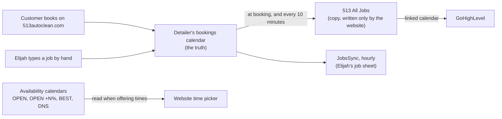

# 513 Auto Clean: handoff for Imperion's GoHighLevel agent

November 27, 2026. For whoever works in the 513 Auto Clean GoHighLevel (GHL) sub-account at Imperion, a person or an AI agent. It explains what you can see, the conventions the data follows, the rules that keep the website's bookings safe, and what we don't know yet about GHL. The other documents in this package go deeper: the booking process flow, the backend logging standard and the 513 All Jobs setup.

**Read this first:** the website is the only thing that books jobs today. Anything you build in GHL reads the jobs; nothing in GHL books, moves or cancels a job yet.

## 1. What you have access to

Shared with Imperion's Google account on November 27, 2026, from the business Google account:

| Calendar | Your access | What it is |
|---|---|---|
| **513 All Jobs** | Make changes and see all event details (no sharing rights) | A copy of every booked job, kept in step by the website. The one to link in GHL. |
| 513 Auto Clean | See all event details | Elijah's real bookings. |
| 513 Kris Bookings | See all event details | Kris's real bookings. |
| 513 Availability | See all event details | Elijah's working hours, fee windows and blocked time. |
| 513 Kris Availability | See all event details | Kris's. |

Not shared: the TEST calendars (test bookings from website previews) and personal calendars. Elijah's job tracking sheet is waiting on Elijah (see question 5 in section 6).

## 2. Where the truth lives



- **The bookings calendars are the truth.** Detailers work from them on their phones. Moves, edits and cancellations happen there.
- **513 All Jobs is a copy.** The website writes it at booking time and checks it every 10 minutes against the bookings calendars. The website never reads it back.
- **The availability calendars decide what times the website offers.** They hold no customer data.

## 3. Conventions

### Times and people
- All times are Eastern (America/New_York).
- Two detailers today: **Elijah** (everything) and **Kris** (interior only: a job with any exterior work is never given to Kris).

### Availability calendars
| Event | Meaning |
|---|---|
| `OPEN` (Busy) | A stretch the detailer can work. The only bookable time. |
| `OPEN +20%` (Free, over an `OPEN`) | Same time, with an early or late fee for starts inside it. Where blocks overlap the higher fee wins. |
| `BEST` | A recommended start time. Never blocks anything. |
| `DNS` | "Do not schedule": blocks time even when marked Free. |
| `Priority: N` in the calendar's description | Who is offered a time first (lowest first). |

**Never add an availability calendar to GHL as a conflict calendar.** The `OPEN` blocks are Busy, so GHL would treat exactly the open hours as unavailable.

### A booking (on a bookings calendar)
- **Title:** starts with the customer's name (`Name: …`). Elijah's hand-typed jobs may look different.
- **Location:** the address, ZIP last.
- **Description:** the job, the price lines (`TOTAL:`, sales tax), and `SOURCE` and `HEARD ABOUT US` blocks. Elijah's job sheet reads these, so their format doesn't change without him.
- **Jobs longer than a day:** one event per working day; days 2 and on are titled `Day N of M` and carry no total.

### A copy on 513 All Jobs
- **Title:** the detailer first: `Kris: Full Interior, Jane Doe`.
- **Description:** a fixed header, then the original word for word:
  ```
  Status: Booked
  Detailer: Kris
  Booking key: <the website's key, or manual:<event id> for a hand-typed job>
  Source calendar: 513 Kris Bookings
  ---
  <the original description>
  ```
- **Colour:** per detailer (Elijah Peacock, Kris Basil, anyone else Blueberry).
- **Cancelled job:** the copy stays, titled `CANCELLED: …`, set to Free so it stops blocking time, coloured Graphite, `Status: Cancelled`. Restoring the original restores the copy.
- **Hidden fields** (private extended properties): `bookingKey` and `sourceId`. An event without `sourceId` wasn't made by the website.
- **Only `Booked` and `Cancelled` exist.** Done and Paid aren't tracked on the calendar.

## 4. Rules

- **Don't edit or delete copies on 513 All Jobs.** The next 10-minute run puts the title, description, time, location, colour and Busy or Free back as the original says. Change the job on the detailer's own calendar instead. Fields GHL adds itself are left alone.
- **No customer books through GHL yet**: no GHL booking link, widget or chat flow that sells times on these calendars. The website doesn't read 513 All Jobs, so it could sell the same hour again. Selling in GHL needs GHL's bookings copied back to a detailer's calendar first (phase 2).
- **An appointment GHL creates on 513 All Jobs** is left alone (and logged as not ours), but the website never sees it.
- **Don't add 513 All Jobs to anything else that counts jobs**, or every job counts twice.
- **Don't reshare** any calendar. Anyone who can see these calendars sees every customer's name, phone and address.
- **Customer data:** the privacy policy (513autoclean.com/privacy, November 27 version) lets "our customer management provider" see booked jobs and job records "to help us run bookings, and may not use them for anything else". Stay inside that.
- **Texting:** the website doesn't send automated texts and promises none. A customer's texting consent is in the owner's booking email, not on the calendar. Don't text from these calendars until consent records and the approved number are in GHL.
- **Website changes** go through Emmett: the site is built from a code repository, and its settings change only by a reviewed change.

## 5. What we don't know yet (our limits with GHL)

We built this around Google Calendar because GHL links to it with no setup on our side. We haven't worked inside the 513 GHL sub-account, so these are open:

- **The connection.** Which GHL user connects Google, and whether GHL's integration handles a secondary calendar (513 All Jobs isn't anyone's primary calendar) as a linked calendar.
- **Two-way sync.** If GHL writes to a copy, the website reverts it within 10 minutes. We don't know whether GHL then writes again, which would loop. One-way (read only) avoids it, if GHL offers it.
- **Cancellations.** Whether GHL handles a copy turned Free and renamed `CANCELLED: …`, or would rather the copy be deleted. The website can do either (one setting).
- **What GHL reads.** Whether it creates contacts or appointments from linked events, and whether it can read the description header (`Status`, `Detailer`) into fields. If it can't, the header is only text to staff.
- **Workflows and reminders.** Whether reminders should come from GHL appointments, and how they'd find the customer's phone and texting consent.
- **Time zones and recurring events.** All copies are single events in Eastern time; we haven't checked how GHL shows them.

**Not built, and waiting on your answers:**
- **GHL's own API:** `GHL-SETUP.md` describes a private integration that would send each booking to GHL as a contact plus an opportunity in a "Website bookings" pipeline (Booked, Confirmed, In Progress, Completed, Paid, Cancelled). It needs a token and location ID from the sub-account, and nothing is built until then.
- **Availability in GHL:** closed-time blocks per detailer from the same engine the website uses.
- **Fee windows, weather pauses, Done and Paid, lead source as a field.**
- **Logs:** the website's logs live in Netlify, which you can't see. Failures reach Elijah by email.

## 6. What we need from you

The full list is section 1 of the package. The ones that decide what we build next:

1. One-way or two-way sync with 513 All Jobs?
2. Show availability only, or eventually sell times in GHL?
3. Google calendars, or GHL's API for the long run (and if the API, the token and location ID per `GHL-SETUP.md`)?
4. Which GHL features you plan to use on these jobs: reminders, pipelines, review requests, follow-ups?
5. What you need from Elijah's job sheet that 513 All Jobs doesn't give you (paid status, revenue, lead source)?

## 7. Where to look

| Need | Document |
|---|---|
| How a booking and a time offer work, and what happens when a step fails | Booking process flow |
| What each system records, and where to read it | Backend logging standard |
| 513 All Jobs in detail, its settings and safety rules | 513 All Jobs setup |
| GHL private integration steps | `GHL-SETUP.md` (repository) |
