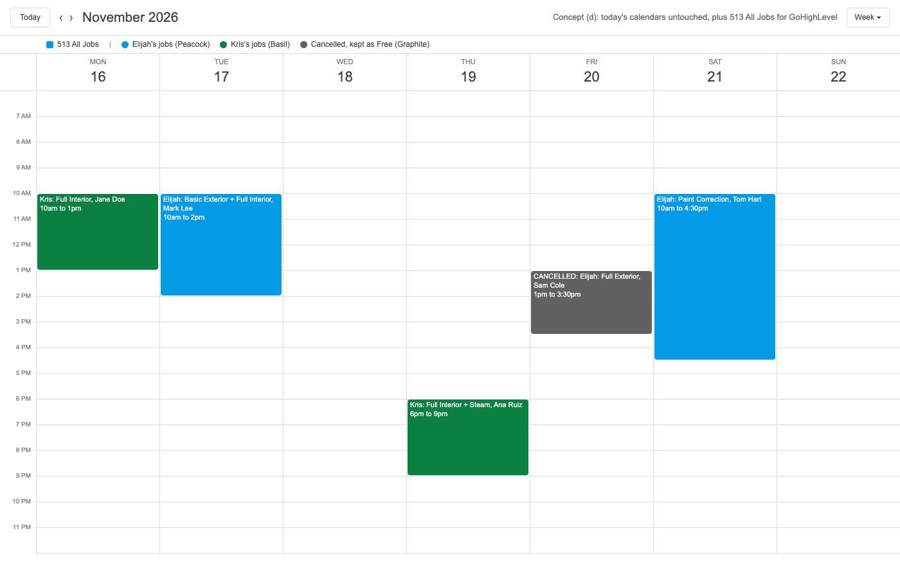

# 513 Auto Clean backend: package for Imperion

November 26, 2026. The website went live tonight with the master calendar for GoHighLevel (GHL), **513 All Jobs**, switched on. We are giving you access to the calendars so you can look before you decide anything. This first section asks the questions we need answered before exposing more to GHL. The three documents after it describe what exists today:

1. **Questions: what GHL should get next** (this section)
2. **What is exposed today**, and what isn't
3. **Booking process flow**: how availability is tracked and shown, and how a booking reaches GHL
4. **Backend logging standard**: what each system records, and where to read it
5. **513 All Jobs setup**: how to link it in GHL, and the rules that keep it safe

Each later document ends with its own open questions. The questions most likely to change what we build are repeated in section 3 below.

---

## 1. Questions: what GHL should get next

Today GHL can see **booked jobs only**. Everything below can be added without changing how the website books. The answers decide which of these we build, and how.

### Detailer availability (open hours)

1. **Should GHL only show when the team is free, or also sell times** (its calendar links or chat widget)?
   - *Show only:* we can add a calendar of "closed" blocks, the times nobody can take a job, worked out by the same engine that offers times on the website. GHL then sees open time as the gaps between busy blocks. GHL can't read "open" blocks: it treats every Busy event as unavailable.
   - *Sell times:* a booking made in GHL never reaches the detailers' calendars today, so the website could sell the same hour again. Selling in GHL needs GHL's bookings copied back first (phase 2).
2. **One team calendar or one per detailer?** A single calendar can only say "someone is free", not who. Kris does interior work only, so a per-detailer view (one GHL calendar or team member each) is the accurate one.
3. **Do you need the raw schedule as well** (each detailer's open hours, best times and blocked days) for staff to look at, or only the bookable result?

### Extra-fee time windows

4. **Do you need the fee windows in GHL?** Two kinds: the short-notice fee (a job booked soon after it's requested) and the fee blocks a detailer marks on their availability calendar (`OPEN +20%`). Both are worked out at booking. GHL can't price a slot. We can expose the windows as informational events (Free, so they block nothing) on a separate calendar, or as a field on each job copy (which fee applied). Which would you use, and for what (staff awareness, or messages to the customer)?

### Weather-driven exterior blocking

5. **Should GHL know when exterior work isn't offered?** Exterior jobs pause for rain and cold (forecast within 7 days, Cincinnati's hourly normals after that), while interior jobs go ahead. GHL can't tell an interior slot from an exterior one on the same calendar. If this matters, it means separate GHL calendars for interior and exterior work, each with its own closed blocks. Is that worth it, or is a daily "exterior paused" note enough?

### Job details and statuses

6. **What should a job carry that it doesn't today?** Each copy has the title, time, address and the full original notes, plus a `Status`, `Detailer`, `Booking key` and `Source calendar` header. Candidates: the price total, the fee applied, interior or exterior, the customer as a structured contact (not a line of text), the source (ad, print code, referral).
7. **Done and Paid statuses:** only Booked and Cancelled are written today. What signal should mark a job paid (a colour on the detailer's phone, a word in the title, the Accounting sheet)?

### How it reaches GHL

8. **Google calendars or GHL's own API?** Everything so far goes through Google calendars, because GHL links to them without any setup on our side. If you give us API access (a GHL location and a token or app), the website could instead send contacts, appointments and blocked times to GHL directly, including the fields Google can't carry. Which do you prefer for the long run?
9. **Which GHL user and Google account** will connect? GHL's integrations are per user, and a linked calendar needs writer access.

### Access you have now

10. **Is read-only (see all event details) enough for your review?** The bookings calendars hold customers' names, phones and addresses, and some job notes hold the owner's payment details. Please don't add any availability calendar (513 Availability, 513 Kris Availability) to GHL as a conflict calendar: their open-hours blocks are marked Busy, so GHL would block exactly the hours that are open.

---

## 2. What is exposed today

| Data | In GHL today? | Where it lives | How it could reach GHL |
|---|---|---|---|
| Every booked job, per detailer, with cancellations | **Yes**, through 513 All Jobs | Each detailer's bookings calendar | Copied by the website at booking, and every 10 minutes |
| Detailers' open hours and best times | No | 513 Availability, 513 Kris Availability | Closed-time blocks (question 1) |
| Bookable times as the website offers them | No | Worked out live by the website | Closed-time blocks from the same engine (question 1) |
| Short-notice fee and `OPEN +20%` fee blocks | No | `config/rush-fee.json`, fee blocks on the availability calendars | Informational events or a field on each job (question 4) |
| Weather pauses for exterior work | No | Forecast and Cincinnati normals, worked out live | Separate interior and exterior calendars, or a daily note (question 5) |
| Who can do what (Kris interior only) | No | Netlify's `DETAILERS` setting | Per-detailer calendars (question 2) |
| Done and Paid | No | The Accounting sheet | Needs a signal first (question 7) |
| Customer as a GHL contact | No (text in the job notes only) | The booking | A contact feed from the website (question 8) |

**What 513 All Jobs looks like** (a sample week, made-up customers): each job titled with the detailer's name first, coloured per detailer, and a cancelled job kept in grey as Free, so GHL stops blocking that time.

---

## 3. Questions already in the documents (short form)

- **One-way or two-way sync** with 513 All Jobs (reminders only, or appointments with workflows)?
- **Cancels under two-way sync:** what GHL does when a copy is deleted, or turned Free and titled `CANCELLED: …`. This decides whether we mark or delete cancelled copies.
- **Edits made in GHL** to a copy are put back by the next 10-minute run, because the detailers' calendars are the truth. Should any flow back instead (phase 2)?
- **Timing:** instant for website bookings, up to 10 minutes for hand-typed jobs, edits and cancels. Enough for your messages?
- **Telling the customer about a change:** moving or cancelling a job sends the customer nothing today. Should GHL send it?
- **Unfinished checkouts:** should they also become a GHL contact with one follow-up? They carry no marketing consent.
- **Monitoring:** do you need a readable log (a daily summary of bookings and failures), or are the owner emails and the master calendar enough?
