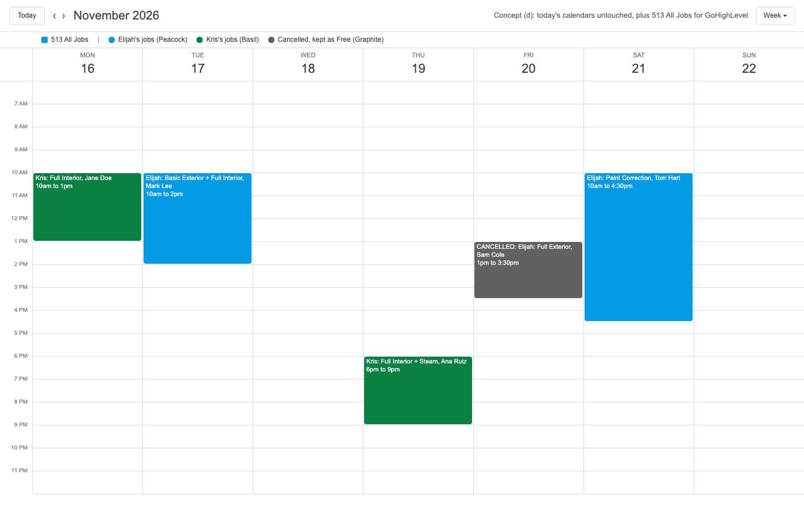
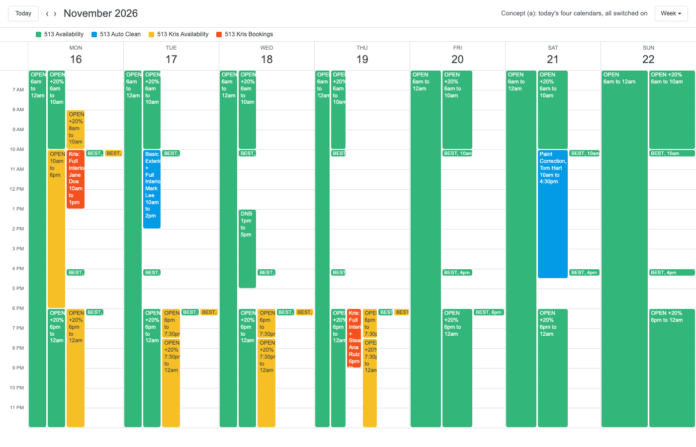
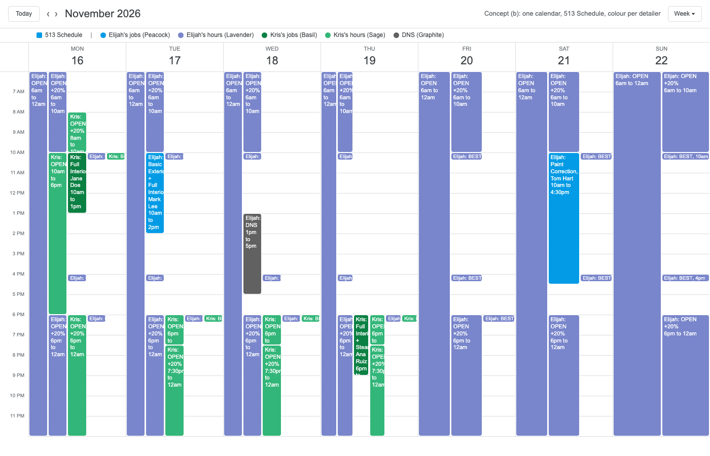
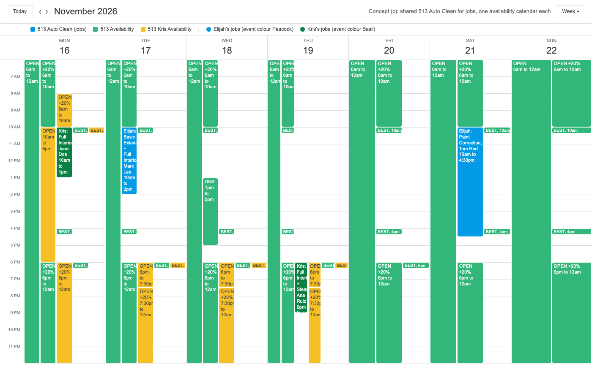

# One Google calendar for GoHighLevel: design spec

Draft, November 14, 2026. Nothing is built. Elijah and Imperion pick a concept first.

**Update, November 26:** concept (d) is built, with the website doing the copying (an instant copy at booking time plus a scheduled reconciler every 10 minutes), not the Apps Script mirror. Setup and rules: `docs/MASTER-CALENDAR-SETUP.md`.

**The ask.** Imperion will connect GoHighLevel (GHL) themselves, later. Their worry is syncing several calendars, so they'd like one Google calendar. Elijah's priorities:
1. each detailer sees and cancels (deletes) their own jobs from their phone;
2. per-detailer hours, early and late fees, best times and priority;
3. Kris does interior only;
4. JobsSync and accounting: a deleted event means cancelled, and revenue counts only once a job is done and paid;
5. adding a detailer stays simple.

**Emmett's direction (November 14).** Don't change or delete the working multi-calendar system. Lead with concept (d): keep today's calendars exactly as they are and add one new calendar, **513 All Jobs**, built for GHL, that could later replace the per-detailer bookings calendars without that being required now.

## Today, in one paragraph

Each detailer has an availability calendar (`OPEN`, `OPEN +20%`, `BEST`, `DNS`, and `Priority: N` in its description) and a bookings calendar. Elijah's are **513 Availability** and **513 Auto Clean**; Kris's are **513 Kris Availability** and **513 Kris Bookings**. The booking form reads availability calendars in full from the browser (they are public and hold nothing private) and bookings calendars as free/busy only, so customer names never leave Google (`calendarCfgFor` in `js/funnel.js`). `send-confirmation.mjs` writes each job to the detailer's bookings calendar (`bookingsCalendarId` from `DETAILERS`, parsed by `crew.ts`), titled `Kris: Full Interior, Jane Doe`; Elijah's jobs carry no name. JobsSync reads the bookings calendars (its `CALENDARS` list) into the Accounting sheet, and marks a row Cancelled when its event is deleted.

## What GHL does with Google calendars (from GHL's help center)

- **Integrations are per GHL user.** "Calendar integrations are tied to individual user profiles, not global company settings", and each user connects their own Google account [1].
- **One linked calendar per user, any number of conflict calendars.** The linked calendar is where bookings sync; conflict calendars only block time [1][2]. "Writer's access is required" to pick a linked calendar [2].
- **Only Busy events block.** "The availability is blocked only if the event is marked as 'BUSY'" [2]. So GHL reads an `OPEN` block (Busy on 513 Availability) as *unavailable*: the opposite of what it means. **No availability calendar should ever be a GHL conflict calendar.**
- **One-way sync is the default.** Google events arrive as blocked slots, with no contact and no workflow. **Two-way sync** turns them into GHL appointments, creates contacts for guests, and can run workflows [2].
- **Not documented:** what a deleted Google event does to a GHL appointment under two-way sync, and whether two GHL users can link the same Google calendar. Both are questions for Imperion (end of this spec).

So GHL's own model is "one Google calendar per person". One calendar for the whole team works only if GHL is used as one user that sees every job, not as the engine that decides who is free.

---

## Concept (d), recommended: today's calendars untouched, plus 513 All Jobs



*The sample week (Monday November 16 to Sunday November 22): Kris's Monday 10am and Thursday 6pm jobs, Elijah's Tuesday and Saturday jobs, and a cancelled Friday job kept as Free. Hours, best times and DNS stay on the availability calendars, which concept (a) shows.*

**What it is.** A new private calendar, **513 All Jobs**, holding a copy of every job and nothing else. The four existing calendars, the booking form and JobsSync work exactly as today. GHL links to 513 All Jobs only.

### How bookings get onto it

| | **Apps Script mirror (recommended first)** | **The website writes a second event** |
|---|---|---|
| How | A `mirrorJobs` function in the JobsSync project, every 5 minutes, reads the calendars in `CALENDARS` and creates, updates or cancels the copy | `send-confirmation.mjs` writes a second event to a new Netlify setting `ALL_JOBS_CALENDAR_ID`, by the same booking key |
| Delay | Up to 5 minutes | Instant |
| Hand-typed jobs, edits, moves, deletes | Caught, because it compares both sides every run | Missed: the website only acts at booking time, so a mirror script is needed anyway |
| Risk to live bookings | None: no change to the website | A new write in the booking path. A failed second write must never fail the booking, and must be told to Elijah (CLAUDE.md, "Live calendars") |
| Code | One new Apps Script file | `writeCalendar`, `_gcal.mjs` (`colorId`), tests |

Start with the mirror. If Imperion needs GHL to see a booking within seconds (an instant confirmation text, say), add the website's second write later and keep the mirror as the reconciler; both use the booking key, so neither makes a duplicate.

Apps Script limits to check: a free Google account gets about 90 minutes of trigger run time a day. A run that reads two calendars for 60 days takes a few seconds, so every 5 minutes fits.

### The event format GHL imports cleanly

- **Title:** the original title, with the detailer always named first: `Kris: Full Interior, Jane Doe`, and `Elijah: …` for jobs on 513 Auto Clean (which carry no name today). `SHORT NOTICE, accept or decline:` and `Day 2 of 2` stay as written, so JobsSync's `DETAILER` and `CONTINUATION_DAY` patterns read the copy the same way.
- **Colour:** by detailer, as an event colour. Elijah Peacock, Kris Basil, Graphite for cancelled. Each detailer's colour is one field in their `CALENDARS` entry.
- **Location:** copied, ZIP last.
- **Description:** a fixed header GHL (or a Zapier step) can parse line by line, then the original description word for word, so `TOTAL:`, `Sales tax…:`, `SOURCE` and `HEARD ABOUT US` are still there:
  ```
  Status: Booked
  Detailer: Kris
  Booking key: 7f3c…   (the website's key; "manual:<event id>" for hand-typed jobs)
  Source calendar: 513 Kris Bookings
  ---
  WHO  Jane Doe  5135550100  jane@example.com
  …the original description…
  ```
- **Status values:** `Booked`, `Done` (the end time has passed), `Paid`, `Cancelled`.
  - `Paid` needs a signal the calendar doesn't carry today. Proposal: the detailer sets the original event's colour to Basil ("paid") from their phone, two taps in Google Calendar; `PAID IN FULL online` in the description also means Paid. Elijah decides (open question 6).
- **Hidden fields** (private extended properties, invisible on phones): `bookingKey` (copied, so JobsSync's duplicate check treats the copy and the original as one booking) and `sourceId` (the original's calendar and event ID).
- **Guests:** none at first. Two-way sync makes GHL contacts from guests [2], but adding the customer as a guest risks Google emailing them an invitation. Imperion decides how they match contacts (open question 2).

### How deletes and cancels stay in step

- **The original calendars are the truth.** Detailers keep deleting on their own bookings calendar from their phone, as the JobsSync README says today.
- **A deleted original:** the mirror marks the copy, never deletes it: title `CANCELLED: Kris: …`, set to Free (so GHL stops blocking the time [2]), Graphite, `Status: Cancelled`. A setting `cancelMode: "mark" | "delete"` switches to deleting if Imperion prefers, so the choice is one value.
- **The same safeguards as JobsSync:** nothing is marked unless every calendar was read without an error, a direct look-up confirms the original is deleted, and no more than 10 look deleted in one run.
- **A restored original** (from Google Calendar's Trash): the copy goes back to Booked.
- **Moved or reassigned:** an original moved to the other bookings calendar keeps its event ID, so the copy follows it and changes its detailer and colour.
- **A copy deleted or edited on 513 All Jobs** (by hand or by GHL): the next run puts it back as the original says. A cancel made in GHL does not cancel the job in phase 1 (open question 3).
- **An appointment GHL creates on 513 All Jobs** has no `sourceId`. The website never reads 513 All Jobs, so that time could be sold twice. Phase 1 rule: customers don't book through GHL. If they will, the mirror copies keyless events back to 513 Auto Clean (open question 4).

### What changes

- **Code (`crew.ts`, `_detailers.mjs`, `send-confirmation.mjs`):** nothing for the mirror.
- **JobsSync:** nothing; 513 All Jobs stays out of its `CALENDARS`. The mirror lives in the same Apps Script project (`tools/jobs-sync/AllJobs.gs`) and shares `CALENDARS`, so the detailer list is kept once.
- **`jobs-sync-contract.test.ts`:** one more check, that `AllJobs.gs` carries the same `DETAILER` and `CONTINUATION_DAY` patterns (as the test already does for `JobsSync.gs`).
- **Adding a detailer:** today's steps, plus a `colour` in their `CALENDARS` line. No new calendar, no GHL step.

### How Elijah's priorities fare

1. **See and cancel own jobs:** unchanged. Each detailer deletes on their own bookings calendar. Kris needs "Make changes to events" on 513 Kris Bookings (not yet shared: his email is still to come). 513 All Jobs is shared only with Elijah and GHL's Google account.
2. **Hours, fees, best times, priority:** unchanged, on the availability calendars.
3. **Kris interior only:** unchanged (`does` in `DETAILERS`).
4. **JobsSync:** unchanged, and 513 All Jobs adds the Done and Paid statuses the README plans, ready for "revenue once done and paid".
5. **Add a detailer:** one extra field.

### Pros, cons, risk, effort

- **Pros:** zero risk to live bookings; Imperion gets the one calendar they asked for, with jobs only; GHL never sees OPEN blocks; a clean path to replacing the bookings calendars later.
- **Cons:** two copies of every job; up to 5 minutes' delay; a script to look after; GHL bookings need phase 2 before customers use them.
- **Migration:** make 513 All Jobs (private); paste `AllJobs.gs`, run it once by hand in a dry-run mode that only logs; check the copies; turn on the 5-minute trigger; give Imperion the calendar.
- **Effort:** about 10 to 14 hours (script 6 to 8, dry runs and checks 2 to 3, docs and the test 2 to 3). The website's second write, if wanted: 4 to 6 more.

### The later switch-over (not required now)

If one calendar should become the real backend, 513 All Jobs becomes concept (c)'s shared bookings calendar:
1. **Reading:** free/busy can't say whose job a busy block is, so a new server function (like `personal-busy.mjs`, with the existing OAuth token) reads 513 All Jobs and returns busy times per detailer, no customer details. `calendarCfgFor` uses it for everyone.
2. **Writing:** `send-confirmation.mjs` writes every job to 513 All Jobs, named and coloured. `bookings` becomes optional in `DETAILERS` (`crew.ts`). The mirror is switched off.
3. **JobsSync:** reads the old bookings calendars up to the switch date and 513 All Jobs after it.
4. **Phones:** each detailer needs "Make changes to events" on 513 All Jobs, which lets them see every customer and delete anyone's job (see "Phone permissions").
5. **Effort:** about 12 to 18 hours, the same as (c). Availability calendars stay.

---

## Alternatives, in brief

### (a) Today's calendars, GHL syncs each one



- **GHL:** two GHL users, two Google connections. Elijah links 513 Auto Clean; Kris, with his own Google account given writer access, links 513 Kris Bookings. Neither availability calendar is connected (OPEN is Busy, so GHL would block his working hours [2]).
- **Changes:** none in code or JobsSync. Adding a detailer adds a GHL user and a connection.
- **Priorities:** all as today.
- **Pros:** no work, GHL's native model. **Cons:** the several-calendar sync Imperion wants to avoid; one more connection to break (an expired token shows a red banner per user [2]).
- **Risk:** none. **Effort:** 1 to 2 hours of notes for Imperion.

### (b) One calendar for everything, detailer named in every event



- **The calendar:** a new **513 Schedule** with `Kris: OPEN`, `Elijah: OPEN +20%`, `Kris: BEST`, `Elijah: DNS` and every job, coloured per detailer (jobs in a strong colour, hours in a pale one).
- **GHL:** one connection, but it sees about 50 hours and best-time events a week. OPEN must be Free or it blocks all working time [2], and under two-way sync every OPEN and BEST would become a GHL appointment.
- **Changes:** the largest.
  - The calendar holds customers' details, so it can't be public. The browser can no longer read it, so a server function reads it and returns each detailer's window.
  - `resolveWindow` and `titleIs` learn name prefixes.
  - `Priority: N` moves into `DETAILERS`: there is only one description.
  - `eventTitle` names Elijah too, and the contract test changes with it.
  - JobsSync's `skipTitle` must skip `Kris: OPEN`, which today it would count as a job.
- **Priorities:** whoever can delete their own jobs can also edit everyone's hours and fees. Adding a detailer is the easiest of all (no new calendar), but means typing their weekly events again with a prefix.
- **Risk:** high. Every recurring OPEN, fee and BEST series is re-typed by hand, and one typo sells wrong hours. **Effort:** 30 to 40 hours.

### (c) One shared bookings calendar, availability per detailer



- **The calendars:** 513 Auto Clean holds every job, named and coloured; 513 Availability and 513 Kris Availability stay as they are.
- **GHL:** one connection to 513 Auto Clean, jobs only.
- **Changes:** what (d)'s switch-over describes, on 513 Auto Clean. Kris's future jobs move there with the Calendar API's `events.move`, which keeps event IDs, so JobsSync rows survive. First deploy code that reads both calendars, then move, then drop 513 Kris Bookings.
- **A cheap variant:** keep reading it as free/busy, so every job blocks every detailer. Not recommended: Kris's Monday jobs would take Elijah's Monday too.
- **Priorities:** Kris needs edit rights on 513 Auto Clean, so he sees every customer's details and can delete Elijah's jobs.
- **Risk:** medium, during the move. **Effort:** 12 to 18 hours.

---

## Phone permissions, for every concept

Google Calendar shares a whole calendar, never single events. The levels are: free/busy only, see all event details, make changes to events, and make changes and manage sharing. Anyone who can delete one event on a calendar can delete or edit every event on it. Being a guest on an event doesn't help: a guest who deletes it only removes it from their own calendar. So "each detailer cancels only their own jobs" holds only while each detailer has their own bookings calendar: today, (a) and (d). In (b) and (c) it becomes a matter of trust, and a deleted event can be restored from Trash for 30 days.

## Side by side

| Priority | (a) today | (b) one for all | (c) shared jobs | **(d) + 513 All Jobs** |
|---|---|---|---|---|
| Own jobs, cancel from phone | Own calendar | Sees and can delete all | Sees and can delete all | **Own calendar** |
| Hours, fees, BEST, priority | As today | Prefixed events, priority in config | As today | **As today** |
| Kris interior only | `DETAILERS` | `DETAILERS` | `DETAILERS` | **`DETAILERS`** |
| JobsSync, done and paid | As today | Rewrite | Calendar list change | **As today, plus statuses** |
| Add a detailer | 2 calendars, a GHL user | 0 calendars | 1 calendar | **2 calendars, a colour** |
| GHL connections | One per person | 1 (with hours) | 1 | **1 (jobs only)** |
| Risk to live bookings | None | High | Medium | **None** |
| Effort | 1 to 2 h | 30 to 40 h | 12 to 18 h | **10 to 14 h** |

## Recommendation

Build **(d)** with the Apps Script mirror. It gives Imperion one jobs-only calendar, changes nothing in the live booking path, keeps each detailer's own calendar for phone cancels, and adds the Done and Paid statuses accounting wants. If a single backend is wanted later, its switch-over turns it into (c) for about 12 to 18 hours. Don't build (b): it puts customers' data and everyone's hours on one calendar that anyone with delete rights can change.

## Open questions

**For Imperion**
1. What will GHL do with the jobs: reminders and review requests (one-way may be enough), or appointments with workflows (two-way)?
2. How should GHL match a job to a contact: a guest email on the event, the `WHO` line in the description, or the website sending the contact to GHL directly?
3. Under two-way sync, what does GHL do when a Google event is deleted, or turned Free and titled CANCELLED? Should a cancel in GHL cancel the real job?
4. Will customers ever book through GHL (its calendar links or chat widget)? If so, phase 2 copies those back to 513 Auto Clean.
5. Is a 5-minute delay fine, or is the website's instant second write needed?

**For Elijah**
6. How should a detailer mark a job paid: the event's colour (Basil) on their phone, a word in the title, or in the sheet?
7. Should a cancelled job stay on 513 All Jobs as Free and grey, or be deleted?
8. Kris's Google email, to share 513 Kris Bookings with "Make changes to events".

## Sources

1. HighLevel Support Portal, "How to Integrate Google Calendar with HighLevel": https://help.gohighlevel.com/support/solutions/articles/155000002369-integrating-google-with-highlevel-calendars
2. HighLevel Support Portal, "Setting Up Linked Calendars & Conflict Calendars": https://help.gohighlevel.com/support/solutions/articles/155000002374-setting-up-linked-calendars-conflict-calendars

Mock-ups: `docs/mockups/one-calendar/concept-{a,b,c,d}.png`, rendered with headless Chrome from a generator kept outside the repo. Colours are Google Calendar's event colours; the sample customers are made up.
